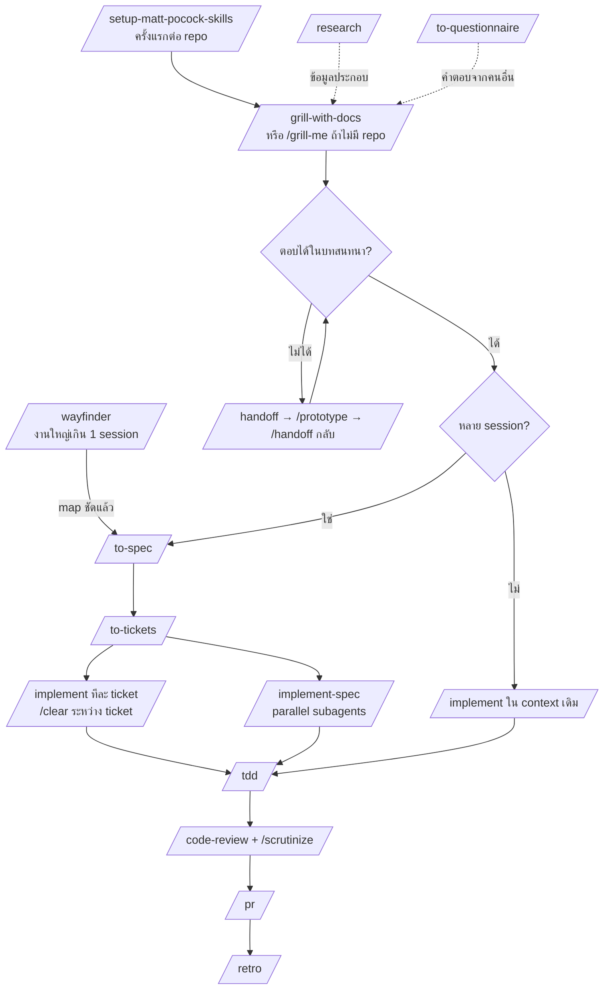

# Skill Map — ใช้ skill ไหนกับงานแบบไหน

ครอบคลุม 3 ชุด: **mattpocock** (`mattpocock_skill/`), **9arm** (`9arm-skills/`), **karpathy** (`andrej-karpathy-skills/`)

> หมายเหตุ: โฟลเดอร์ `skills/` เป็น clone ซ้ำของ `mattpocock_skill/` (ไฟล์เหมือนกันทุกไฟล์ ต่างกันแค่ `.git`) — เก็บไว้ชุดเดียวก็พอ
>
> 🔒 = `disable-model-invocation` (ต้องพิมพ์ `/ชื่อ` เอง agent ไม่เรียกให้อัตโนมัติ)

---

## 1. Quick lookup: "ตอนนี้กำลังจะทำอะไร?"

| สถานการณ์ | ใช้ skill | ชุด |
|---|---|---|
| เริ่มใช้ engineering skills ใน repo ใหม่ครั้งแรก | `/setup-matt-pocock-skills` 🔒 | matt |
| จำไม่ได้ว่าควรใช้ skill ไหน | `/ask-matt` 🔒 | matt |
| เขียน / แก้ / review โค้ด (ทุกครั้ง, เป็นพื้นฐาน) | `karpathy-guidelines` | karpathy |
| มีไอเดีย อยากขัดเกลาก่อนลงมือ (อยู่ใน repo) | `/grill-with-docs` 🔒 | matt |
| มีไอเดีย/แผน/งานเขียน แต่ไม่มี repo | `/grill-me` 🔒 | matt |
| คำถามดีไซน์ที่ตอบบนกระดาษไม่ได้ (state, logic, UI) | `/prototype` | matt |
| ต้องหาข้อมูล docs/API จากแหล่งต้นทาง | `/research` | matt |
| ติดอยู่เพราะคำตอบอยู่ในหัวคนอื่น | `/to-questionnaire` 🔒 | matt |
| งานใหญ่ หมอกเยอะ เกิน 1 session | `/wayfinder` 🔒 | matt |
| สรุปบทสนทนาเป็น spec | `/to-spec` 🔒 | matt |
| แตก spec เป็น ticket | `/to-tickets` 🔒 | matt |
| ลงมือทำทีละ ticket / งานเล็ก | `/implement` 🔒 | matt |
| ลงมือทำทั้ง spec แบบ parallel subagents | `/implement-spec` 🔒 | matt |
| เขียนโค้ดแบบ test-first | `/tdd` | matt |
| งานจุกจิก กลไกล้วน (rename, format, boilerplate, รัน test) | `qwen-agent` | 9arm |
| Review diff เทียบ coding standards + spec | `/code-review` (ของ matt) | matt |
| Review แบบคนนอก: "ทำไมไม่ทำแบบที่ง่ายกว่านี้?" + trace code path จริง | `/scrutinize` | 9arm |
| เขียน PR description | `/pr` | matt |
| บั๊กทั่วไป เพิ่งเริ่ม debug | `/debug-mantra` | 9arm |
| บั๊กยาก / flaky / regression / ช้า | `/diagnosing-bugs` | matt |
| แก้บั๊กเสร็จแล้ว ต้องเขียน RCA | `/post-mortem` | 9arm |
| สรุปงานให้หัวหน้า/PM/exec (Slack, JIRA, email, standup) | `/management-talk` | 9arm |
| จบ session อยากปรับ environment ให้ครั้งหน้าดีขึ้น | `/retro` 🔒 | matt |
| Issue/PR จากคนอื่นกองเต็ม | `/triage` 🔒 | matt |
| ว่างๆ อยากปรับสถาปัตยกรรม | `/improve-codebase-architecture` 🔒 | matt |
| ออกแบบ interface / seam ของ module | `/codebase-design` | matt |
| ศัพท์ในโดเมนสับสน, เขียน GLOSSARY / ADR | `/domain-modeling` | matt |
| ขั้นตอนที่มนุษย์ต้องทำเอง (credentials, dashboard, infra) | `/wizard` | matt |
| Agent วนลูป / context ใกล้เต็ม | `qwenchance` | 9arm |
| ย้ายงานไป harness/directory/คนอื่น | `/handoff` 🔒 | matt |
| ข้อความล่าสุดของ agent อ่านไม่รู้เรื่อง | `/wait-what` 🔒 | matt |
| อยากเรียนรู้ concept ใหม่หลาย session | `/teach` 🔒 | matt |
| เขียน skill / CLAUDE.md / AGENTS.md | `/writing-for-agents` | matt |
| ตั้ง hook กัน `git push`, `reset --hard` ฯลฯ | `/git-guardrails-claude-code` | matt |
| ตั้ง Husky + lint-staged + typecheck | `/setup-pre-commit` | matt |
| แทน `as` ใน test ด้วย shoehorn | `/migrate-to-shoehorn` | matt |
| สร้างโครง exercise สำหรับคอร์ส | `/scaffold-exercises` | matt |

---

## 2. Workflow หลัก: Idea → Ship



**ทุกขั้นที่เขียนโค้ด** ให้ `karpathy-guidelines` คุมพฤติกรรม (เปลี่ยนเฉพาะที่จำเป็น, ไม่ over-engineer, บอก assumption, มีเกณฑ์ความสำเร็จที่ verify ได้)

**Context hygiene:** grill → to-spec → to-tickets ให้อยู่ใน context เดียวกันโดยไม่ compact; `/implement` แต่ละ ticket เริ่มใหม่ได้

---

## 3. Workflow บั๊ก

```
มีบั๊ก
 ├─ ดูง่าย / เพิ่งเริ่ม ─────────→ /debug-mantra   (reproduce → trace → falsify → cross-ref)
 └─ ยาก / flaky / regression / ช้า → /diagnosing-bugs (หา feedback loop ที่แดงก่อน แล้วแก้ + regression test)
          │
          ▼
     /scrutinize        ← ตรวจว่า fix ทำสิ่งที่อ้างจริง
          │
          ▼
     /post-mortem       ← RCA สำหรับวิศวกร (ต้องมี repro + root cause + fix ที่ validate แล้ว)
          │
          ├─→ /management-talk  ← ฉบับสั้นสำหรับหัวหน้า/PM
          └─→ /retro            ← อะไรจะกันบั๊กนี้ได้? ถ้าคำตอบคือ "ไม่มี seam" → /improve-codebase-architecture
```

---

## 4. Workflow อื่นๆ

**Issue จากภายนอก:** `/triage` → issue พร้อมสำหรับ agent → `/implement` (อย่า triage ticket ที่ `/to-tickets` สร้างเอง)

**ดูแล codebase:** `/improve-codebase-architecture` → เลือก candidate → `/codebase-design` (ออกแบบ) → เข้า main flow ที่ `/grill-with-docs`

**ภาษา/ศัพท์:** `/domain-modeling` (GLOSSARY, ADR) — `/grill-with-docs` เรียกใช้อยู่แล้ว; ถ้า agent พูดศัพท์เทคนิคจนงง → `/wait-what`

**รายงานผู้บริหาร:** งานวิศวกรรมใดๆ → `/management-talk` (เลือก channel: JIRA / Slack / standup / email / meeting)

---

## 5. Session management (ตอนจบแต่ละ phase)

ไล่จากบนลงล่าง ข้อแรกที่ใช่คือคำตอบ (จาก `ask-matt/PHASE-BOUNDARIES.md`):

1. **Continue** — phase ถัดไปต้องใช้ context นี้ หรือยังเหลือ ~150k tokens
2. **`/clear`** — context ไม่เกี่ยวกับงานถัดไปแล้ว
3. **`/handoff`** — ย้าย harness / directory / ส่งให้คนอื่น / แตก side task
4. **Subagent** — งานแคบพอให้รันเองได้ (ถ้าเป็นงานกลไก → `qwen-agent` ประหยัดกว่า)
5. **`/compact`** — default สุดท้าย

ระหว่าง phase ถ้า agent เริ่มวน อ่านไฟล์ซ้ำ หรือ context ใกล้เต็ม → `qwenchance`

---

## 6. Skill ที่ซ้อนกัน — เลือกตัวไหน

| คู่ | ใช้ตัวแรกเมื่อ | ใช้ตัวที่สองเมื่อ |
|---|---|---|
| `debug-mantra` vs `diagnosing-bugs` | บั๊กทั่วไป อยากได้วินัยพื้นฐาน | บั๊กดื้อ ต้องสร้าง feedback loop ก่อน |
| `code-review` (matt) vs `scrutinize` | เช็คตาม standards ของ repo + ตรงกับ spec ไหม | มุมคนนอก: เจตนาถูกไหม มีทางง่ายกว่าไหม trace path จริง — **ใช้คู่กันได้** |
| `grill-with-docs` vs `grill-me` vs `grilling` | อยู่ใน repo (เก็บ GLOSSARY/ADR) | ไม่มี repo / ต้องการแค่ primitive ล้วน |
| `handoff` vs `qwenchance` | ตั้งใจย้ายงานไปที่อื่น | กู้ session ที่กำลังวน/ใกล้เต็ม (มี handoff ในตัว) |
| `implement` vs `implement-spec` | ทำทีละ ticket ขับเอง | ปล่อย orchestrate ทั้ง spec |
| `post-mortem` vs `management-talk` | ผู้อ่านเป็นวิศวกร | ผู้อ่านเป็นหัวหน้า/PM (มักทำต่อจาก post-mortem) |

⚠️ **ชื่อชน:** `/code-review` ของ matt ชนกับ `/code-review` ที่ติดมากับ Claude Code (ตัว built-in หา correctness bug ตาม effort level; ตัวของ matt review สองแกน Standards + Spec) — ถ้าติดตั้งทั้งคู่ให้ระบุให้ชัดว่าจะใช้ตัวไหน

---

## 7. ยังเป็น draft (`in-progress/`) — ยังไม่ควรพึ่ง

| Skill | ทำอะไร |
|---|---|
| `chief-of-staff` | ไล่เป้าหมายยาวใน session เดียวด้วย subagents |
| `claude-handoff` | handoff ไปยัง background agent ที่เริ่มงานทันที |
| `loop-me` | grill เพื่อออกแบบ workflow ใน workspace |
| `setup-ts-deep-modules` | ตั้ง dependency-cruiser บังคับ deep modules ใน TS |
| `writing-fragments` → `writing-beats` → `writing-shape` | pipeline เขียนบทความ: ขุดวัตถุดิบ → เรียงเป็น beats → ขึ้นรูปเป็นบทความ |
